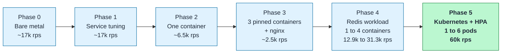
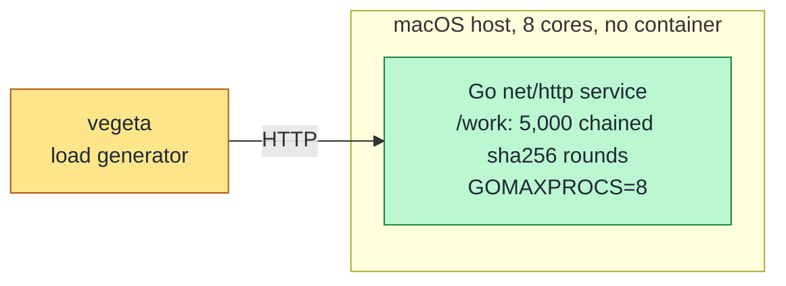
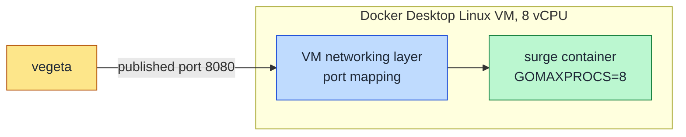
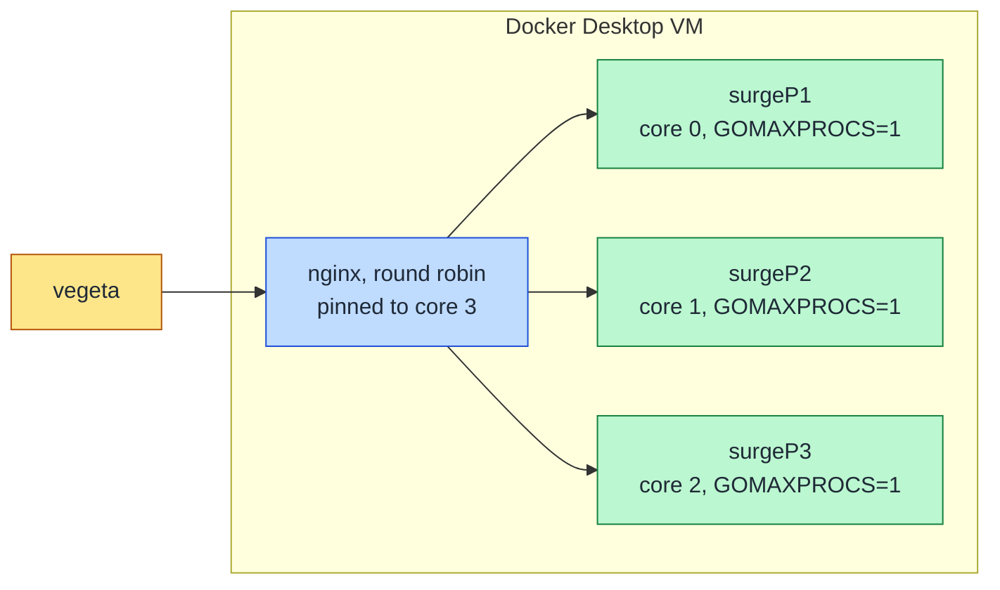
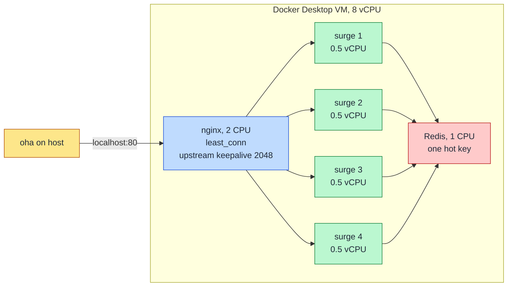
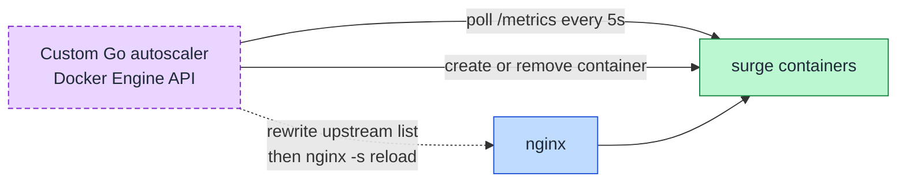
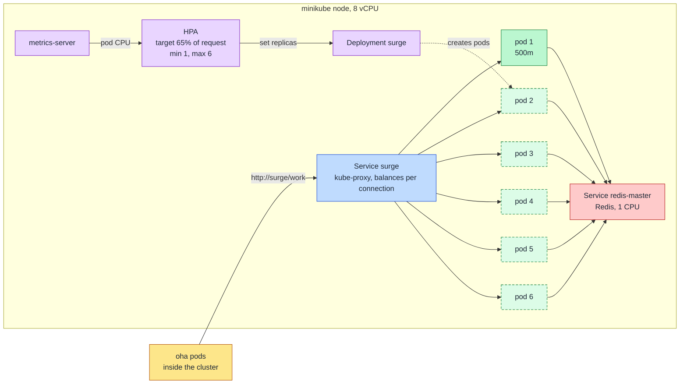
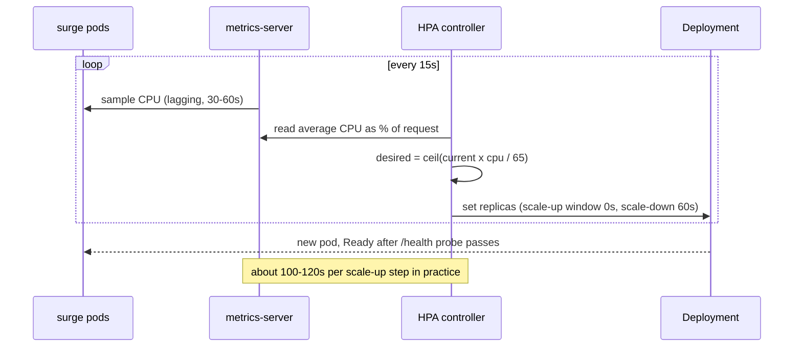
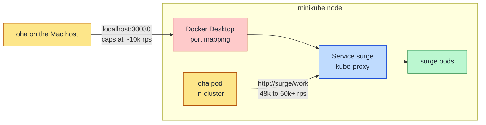

# Project Surge

Scaling a Go HTTP service from **12.9k to 60k requests/sec** on a single 8-core laptop, by moving from manually scaled Docker containers behind nginx to Kubernetes with a Horizontal Pod Autoscaler (HPA). The point of the project is the method: measure each stage, find the bottleneck, fix it, re-measure, and document what the numbers do and do not prove.

## Results

| Stage | Throughput | What limited it |
|---|---|---|
| 1 container (0.5 vCPU) + nginx + Redis | 12.9k req/sec | the container's CPU quota |
| 4 containers, scaled by hand | 31.3k req/sec (plateau) | nginx and the machine's total CPU, not the container count |
| Kubernetes + HPA (1 to 6 pods), load from inside the cluster | **59.97k req/sec sustained**, 100% success, ~1.2ms avg latency | the load generator's rate cap (headroom remained) |

Autoscaling run (30s bursts, 1,500 connections, rate cap 60k/s, HPA starting at 1 pod):

| Bursts | Req/sec | Avg latency | State |
|---|---|---|---|
| 1-3 | ~15.5k | ~96ms | 1 pod, saturated |
| 4-7 | ~30.5k | ~49ms | 2 pods, saturated |
| 8-10 | ~49.5k | ~30ms | 3 pods, saturated |
| 11-16 | 59.97k (the cap) | 1.1-1.4ms | capacity exceeds demand |

All 16 bursts had 100% success. The HPA stepped 1, 2, 3, 5, 6 pods without manual intervention and scaled back to 1 after the load stopped. Scaling was near-linear, about 15.5k req/sec per 0.5-vCPU pod.

## Architecture, phase by phase

The project went through six stages. Each diagram shows the request path at that stage, with the limit that was found.

> **Workload change.** Phases 0-3 used a CPU-bound endpoint (5,000 chained sha256 rounds per request). From Phase 4 on, `/work` reads one key from Redis. The two workloads have different cost per request, so the numbers on either side of that line are **not comparable**. Compare within a workload only.

### Phase 0 and 1: bare-metal baseline and service tuning

Find the naive ceiling of the Go service, then tune it (server timeouts, hot-path allocations, explicit `GOMAXPROCS`). Tuning bounded worst-case latency but did not raise the ceiling: the service was CPU-bound.

### Phase 2: containerize and measure the container tax

Same code and the same 8 cores, inside a Docker container. Ceiling dropped from ~17k to ~6.5k req/sec. Docker Desktop on macOS routes published ports through its VM networking layer, which became a throughput limit, not just a latency cost.

### Phase 3: static horizontal scale-out behind nginx

Three containers pinned to separate cores, nginx round robin in front. Per-core ceiling was ~1.2k req/sec, so the linear target was ~3.6k, but the pool reached ~2.5k (~70% efficiency). Causes: round robin is bounded by the weakest backend, and an unpinned nginx stole CPU from the backend cores (pinning it to core 3 improved mean latency ~113x at 2,400 req/sec).

### Phase 4: Redis workload, containers scaled by hand (12.9k to 31.3k)

`/work` now reads one Redis key. The unit of scaling is one 0.5-vCPU container with `GOMAXPROCS=1`. nginx uses `least_conn` and upstream keepalive (without it, it ran out of ephemeral ports). Load generator switched to `oha`. Throughput scaled 12.9k, 22.6k, 31.1k, then plateaued at 31.3k with 4 containers: the machine as a whole was out of CPU (nginx ~75% of 2 cores, Redis ~75% of 1 core, plus the load generator and the Docker VM).

The container count was set by hand, and nginx needed a config edit plus restart for every change (it caches upstream IPs at startup).

### Phase 4 (attempt): custom Go autoscaler, abandoned

The first plan was a hand-written autoscaler on the Docker Engine API. While building it, the nginx DNS-caching problem showed up: recreating a backend gives it a new IP, and nginx keeps sending traffic to the dead one until reloaded. Every scale event would need a config rewrite plus `nginx -s reload`. This was the reason to move to Kubernetes, where the Service tracks pods natively.

### Phase 5: Kubernetes with a Horizontal Pod Autoscaler (60k)

kube-proxy replaces nginx, and the HPA replaces manual scaling. Each pod is 0.5 vCPU (request = limit) with `GOMAXPROCS=1`, the same unit as Phase 4. Dashed pods are the ones the HPA adds under load.

How the autoscaler decides, and why it takes minutes to react:

### How the load was generated (and why it matters)

Where the load generator sits decides what is being measured. From the Mac, every request passes through Docker Desktop's port mapping, which capped the test at ~10k req/sec regardless of pod count. The same pods served 48k+ when `oha` ran as a pod inside the cluster.

kube-proxy balances per TCP connection, so one long keep-alive run opens all its connections on the first pod and new pods never receive traffic (the HPA stalled at 2 pods). The autoscaling test therefore uses repeated 30s bursts, each of which reconnects.

### Code layout

- **`main.go`**: Go `net/http` service. `/work` reads one key from Redis (go-redis, pre-warmed connection pool); `/health` is the readiness probe. Explicit server timeouts.
- **Docker**: `docker-compose.yml`, `nginx.conf`, `Dockerfile`.
- **Kubernetes** (`k8s/`): Redis Deployment and Service, surge Deployment (request = limit = 500m), Service, and an HPA (min 1, max 6, CPU target 65% of request, scale-up stabilization 0s, scale-down 60s).

## Bottlenecks found and fixed

| Bottleneck | Fix |
|---|---|
| nginx opened a new upstream connection per request, causing ephemeral port exhaustion (`99: Address not available`) | upstream `keepalive` with HTTP/1.1 and `Connection ""` |
| go-redis connection storm under sudden concurrency | explicit pool size and pre-warmed idle connections |
| Redis Cluster cannot scale a single hot key (all reads hit one node) | kept a single Redis; confirmed with `cmdstat_get` |
| `GOMAXPROCS` defaulted to the node's cores under a CPU quota | set to 1 per sub-1-core container (~3x better per-core efficiency) |
| vegeta used enough CPU to hide ~35% of capacity | switched to `oha` |
| metrics-server rejected the kubelet's self-signed cert on minikube (HPA showed `<unknown>`) | `--kubelet-insecure-tls` |
| HPA target of 10-30% scaled on idle noise | 65% of the 500m request |
| Host-to-cluster path capped the test at ~10k req/sec (Docker Desktop port mapping), while the same pods served 48k+ from inside the cluster | run the load generator as a pod inside the cluster |
| kube-proxy balances per TCP connection, so a single long keep-alive run never used new pods and the HPA stalled at 2 pods | repeated short bursts that reconnect (production: L7 balancing or connection recycling) |

The full log, including dead ends and the numbers behind each step, is in [BOTTLENECKS.md](BOTTLENECKS.md).

## What these numbers do and do not show

- 60k req/sec is the load generator's **rate cap**, not a measured ceiling. Latency was still ~1ms, so the real limit is higher.
- p99 latency was not recorded for the 60k runs.
- The comparison with Docker is not strictly like for like: the Docker runs had `oha` on the host, the Kubernetes runs had it inside the cluster. Most of the gain comes from removing nginx (~1.5-2 cores at the plateau) and the Docker Desktop host path from the request path, plus automatic scaling. It does not show that Kubernetes is inherently faster than Docker.
- Single 8-core laptop (6 performance + 2 efficiency cores). The load generator, Redis, the pods and the cluster all share it. One hot Redis key. No ingress or edge load balancer in the path.
- HPA reaction is slow: about 100-120s per scale-up step, roughly 5 minutes from 1 pod to a pool that fully served 60k.

## Reproduce

- Docker baseline: [DOCKER_RUNBOOK.md](DOCKER_RUNBOOK.md)
- Kubernetes + HPA (minikube): [K8S_RUNBOOK.md](K8S_RUNBOOK.md)
- Results summary: [SUMMARY.md](SUMMARY.md)

Tools: Go, Docker Compose, nginx, Redis, minikube, kubectl, [oha](https://github.com/hatoo/oha).
